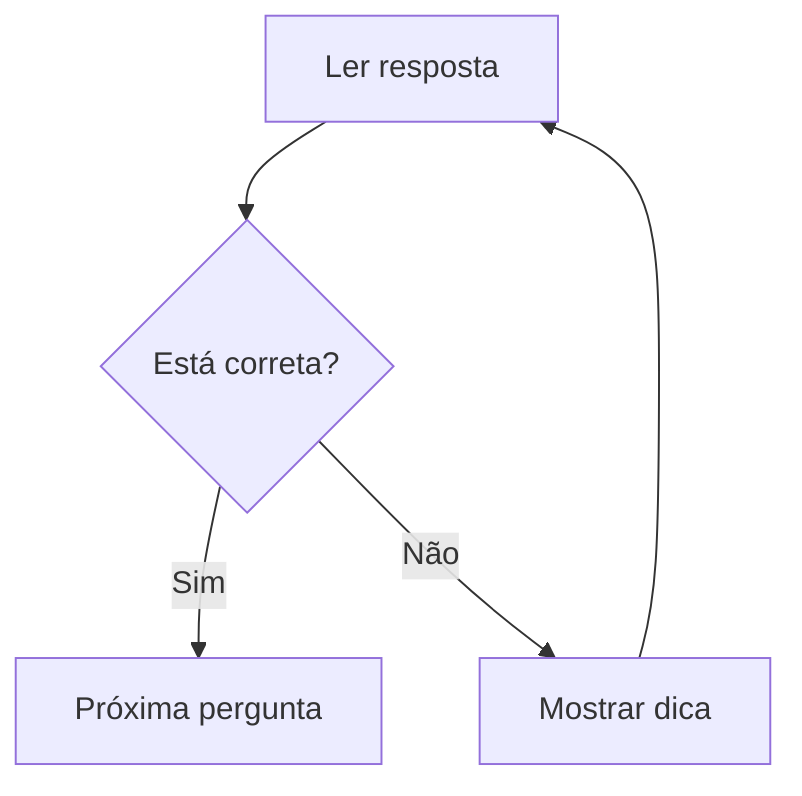

# Markdown na prática

Um guia para escrever documentos, montar um README e preparar uma versão em PDF.

Markdown é texto com sinais de formatação. Se você escrever ``**Enter**``, a pré-visualização mostrará **Enter**. O arquivo `.md` guarda os asteriscos para que você possa voltar, editar a palavra e ver o resultado mudar.

## Sumário

1. [Títulos, parágrafos e quebras de linha](#títulos-parágrafos-e-quebras-de-linha)
2. [Negrito, itálico e citações](#negrito-itálico-e-citações)
3. [Marca-texto e alertas](#marca-texto-e-alertas)
4. [Listas e tarefas](#listas-e-tarefas)
5. [Links e sumário clicável](#links-e-sumário-clicável)
6. [Imagens e capturas de tela](#imagens-e-capturas-de-tela)
7. [Comandos e blocos de código](#comandos-e-blocos-de-código)
8. [Tabelas](#tabelas)
9. [Fluxogramas com Mermaid](#fluxogramas-com-mermaid)
10. [Pré-visualização e exportação para PDF](#pré-visualização-e-exportação-para-pdf)
11. [Oficina de README](#oficina-de-readme)

**Para acompanhar no VS Code**, abra este `.md` e pressione `Ctrl+K`, solte as teclas e pressione `V`. Você verá o texto e a pré-visualização lado a lado. Crie um segundo arquivo chamado `treino.md` para experimentar os exemplos.

<!-- pagina -->

## Títulos, parágrafos e quebras de linha

Pense no título como o nome do projeto e nos subtítulos como as divisões do manual. Use `#` para o título principal, `##` para uma seção e `###` para uma subseção. Insira um espaço depois dos sinais. Há seis níveis, de `#` a `######`.

**Escreva no .md**

```markdown
# Questionário interativo

## Modos de jogo

### Modo simples

Responda à pergunta
e pressione Enter.

Pergunta 1\
Qual comando mostra a pasta atual?
```

**Como fica a leitura**

# Questionário interativo

## Modos de jogo

### Modo simples

Responda à pergunta
e pressione Enter.

Pergunta 1\
Qual comando mostra a pasta atual?

**O que mudou entre as linhas?** Um `Enter` simples geralmente mantém o texto no mesmo parágrafo. Uma linha em branco começa outro parágrafo. A barra invertida (`\`) no fim da linha força a quebra dentro do parágrafo. Dois espaços antes de `Enter` também fazem isso, mas alguns editores removem espaços finais ao salvar.

**Experimente.** Apague apenas a barra depois de *Pergunta 1*. Observe onde a pergunta passa a começar.

[↑ Voltar ao sumário](#sumário)

<!-- pagina -->

## Negrito, itálico e citações

Em um passo a passo, o negrito ajuda o leitor a localizar a tecla ou a opção que precisa escolher. O itálico dá ênfase mais leve a um termo. Uma citação separa a fala de alguém do texto que você está escrevendo.

**Escreva no .md**

```markdown
Pressione **Enter** para começar.
Escolha o *modo simples* para a primeira rodada.

> Gostei de ver o comando logo depois da resposta.
```

**Como fica**

Pressione **Enter** para começar.
Escolha o *modo simples* para a primeira rodada.

> Gostei de ver o comando logo depois da resposta.

| O que você quer mostrar | O que digitar | Resultado |
| --- | --- | --- |
| Uma ação em destaque | `**Salvar**` | **Salvar** |
| Ênfase em um termo | `*rascunho*` | *rascunho* |
| Duas ênfases juntas | `***obrigatório***` | ***obrigatório*** |
| Os próprios asteriscos | `\*teste\*` | \*teste\* |

O sinal `>` no início cria a citação. Para citar várias linhas, coloque `>` em cada uma. Se quiser uma linha vazia dentro da mesma citação, deixe nessa linha apenas o `>`.

**Experimente.** Na frase “Escolha o modo simples e pressione Enter”, aplique itálico ao nome do modo e negrito à tecla. Depois compare o resultado com `Escolha o *modo simples* e pressione **Enter**.`

[↑ Voltar ao sumário](#sumário)

<!-- pagina -->

## Marca-texto e alertas

O que você quer que o leitor perceba? Para destacar duas palavras dentro de uma frase, um marca-texto pode bastar. Para chamar atenção para uma instrução inteira, um alerta ganha uma linha própria. O aplicativo que abre o arquivo determina quais desses recursos aparecem.

**Marcar uma expressão**

| Onde escrever | O que digitar | Efeito esperado |
| --- | --- | --- |
| Obsidian | `==resposta correta==` | Fundo de destaque nas palavras entre os sinais. |
| Prévia que aceita o HTML `<mark>` | `<mark>resposta correta</mark>` | Trecho marcado conforme o tema do leitor. |
| Leitores de Markdown em geral | `**resposta correta**` | Ênfase em negrito. |

Neste exemplo em HTML, a tela indica <mark>resposta correta</mark> e avança. Se o leitor exibir literalmente `==resposta correta==`, ele está tratando os sinais de igual como texto. Para manter a ênfase em vários leitores, use negrito.

**Criar um alerta no GitHub**

```markdown
> [!TIP]
> Abra a pré-visualização ao lado para acompanhar a edição.
```

**Como fica em um leitor com suporte**

> [!TIP]
> Abra a pré-visualização ao lado para acompanhar a edição.

A primeira linha define o tipo e a segunda traz a mensagem. No GitHub, `NOTE` sinaliza uma observação, `TIP` uma dica, `IMPORTANT` um ponto essencial, `WARNING` um aviso e `CAUTION` um risco. Um leitor sem suporte pode mostrar a citação com o marcador `[!TIP]` visível.

**Experimente.** Troque `TIP` por `IMPORTANT`. Depois abra o mesmo arquivo em dois leitores e compare o alerta e a frase marcada.

[↑ Voltar ao sumário](#sumário)

<!-- pagina -->

## Listas e tarefas

Use marcadores quando a ordem dos itens for livre. Numere instruções que precisam ser seguidas em sequência. Use caixas de seleção para registrar quais etapas você já concluiu.

**Escreva no .md**

```markdown
- Linux Mint
- VS Code

1. Abra a pasta do projeto.
2. Crie o arquivo de treino.
   - Use o nome `treino.md`.
   - Salve na pasta do projeto.

- [x] Criar o arquivo
- [ ] Conferir a prévia
```

**Como fica**

- Linux Mint
- VS Code

1. Abra a pasta do projeto.
2. Crie o arquivo de treino.
   - Use o nome `treino.md`.
   - Salve na pasta do projeto.

- [x] Criar o arquivo
- [ ] Conferir a prévia

**Como controlar o recuo.** No exemplo, os três espaços antes de cada subitem alinham o hífen com o começo do texto de “Crie”. Assim os dois detalhes ficam dentro do passo 2.

**Experimente.** Marque a segunda tarefa no texto-fonte trocando `[ ]` por `[x]`. O espaço entre os colchetes representa a caixa vazia. No PDF, as caixas registram o estado que estavam exibindo no momento da exportação.

[↑ Voltar ao sumário](#sumário)

<!-- pagina -->

## Links e sumário clicável

Nos colchetes, escreva o texto em que o leitor vai clicar. Nos parênteses, escreva o destino. Ele pode ser um endereço na web, outro arquivo do projeto ou um ponto do mesmo documento.

**Monte um sumário de duas linhas**

```markdown
- [Como jogar](#como-jogar)
- [Como pontuar](#como-pontuar)

### Como jogar

Digite a resposta e pressione **Enter**.

### Como pontuar

Cada acerto vale um ponto.
```

**Teste os dois destinos**

- [Como jogar](#como-jogar)
- [Como pontuar](#como-pontuar)

### Como jogar

Digite a resposta e pressione **Enter**.

### Como pontuar

Cada acerto vale um ponto.

**Como encontrar a âncora.** No GitHub, `Como jogar` gera `#como-jogar`. Títulos repetidos podem ganhar sufixos como `-1`. Para acertar acentos, pontuação ou nomes repetidos, copie o destino pelo ícone de link ao lado do título na página renderizada.

**Outros destinos.** `[Manual](docs/manual.md)` abre um arquivo relativo à pasta do documento. `[VS Code](https://code.visualstudio.com/)` abre um site. Se renomear um título ou mover um arquivo, atualize os links que apontam para ele.

[↑ Voltar ao sumário](#sumário)

<!-- pagina -->

## Imagens e capturas de tela

A sintaxe parece a de um link, com uma exclamação antes dos colchetes. Nos colchetes vai uma descrição do que importa na imagem. Entre parênteses vai o caminho do arquivo ou o endereço da imagem.

**Incluir uma captura do seu computador**

```markdown

```

Para testar essa linha, salve sua própria captura como `menu.png` dentro de uma pasta chamada `imagens`, ao lado do `treino.md`. Assim, ao compartilhar o projeto, você pode levar a pasta junto. No Linux, confira também as maiúsculas e minúsculas do nome.

**Ver um exemplo que já tem imagem**

```markdown
![Pré-visualização de um README no VS Code][previa]

[previa]: https://code.visualstudio.com/assets/docs/languages/Markdown/preview.png
```

![Pré-visualização de um README no VS Code][previa]

*Na captura da documentação do VS Code, um título do README já aparece formatado. Observe o peso das letras em relação ao texto ao redor.* [Fonte da captura](https://code.visualstudio.com/docs/languages/markdown#_markdown-preview)

O rótulo `[previa]` liga o texto alternativo ao endereço definido abaixo. Essa forma mantém o parágrafo legível quando o endereço é comprido. No arquivo editável, essa captura é carregada pela internet. O PDF já contém a imagem.

[previa]: https://code.visualstudio.com/assets/docs/languages/Markdown/preview.png

[↑ Voltar ao sumário](#sumário)

<!-- pagina -->

## Comandos e blocos de código

Uma crase de cada lado delimita um comando dentro da frase. Três crases em linhas próprias delimitam um bloco e preservam suas quebras e seu recuo. Depois das crases de abertura, indique a linguagem para que o leitor possa colorir a sintaxe.

**Escreva no .md**

````markdown
Use `pwd` para mostrar a pasta atual.

```bash
for nome in Ana Leo; do
    printf 'Olá, %s!\n' "$nome"
done
```
````

**Como fica**

Use `pwd` para mostrar a pasta atual.

```bash
for nome in Ana Leo; do
    printf 'Olá, %s!\n' "$nome"
done
```

Se você copiar apenas o conteúdo desse bloco para o Bash e executá-lo, você verá estas duas linhas no terminal.

```text
Olá, Ana!
Olá, Leo!
```

**Qual nome vem depois das crases?** Use `bash` para Shell Script, `python` para Python e `text` para uma saída de terminal. A prévia exibe o código. Quem executa o laço é o Bash.

**Como ensinar a própria sintaxe.** Para que as três crases apareçam no seu manual, coloque o exemplo inteiro entre linhas de **quatro** crases. Foi assim que o primeiro quadro desta página foi escrito.

[↑ Voltar ao sumário](#sumário)

<!-- pagina -->

## Tabelas

Use uma tabela quando o leitor precisar comparar as mesmas informações em várias linhas. Em um README, ela pode funcionar como uma consulta rápida sobre os modos de um jogo.

**Escreva no .md**

```markdown
| Modo | Tipo de resposta | Tentativas |
| :--- | :---: | ---: |
| Simples | Texto | 2 |
| Treino | Alternativas | 10 |
```

**Como fica**

| Modo | Tipo de resposta | Tentativas |
| :--- | :---: | ---: |
| Simples | Texto | 2 |
| Treino | Alternativas | 10 |

**Leia a segunda linha do exemplo.** Os hífens separam o cabeçalho dos dados. A posição dos dois-pontos indica o alinhamento de cada coluna. Em `:---` ficam à esquerda, em `:---:` ficam nas duas pontas para centralizar e em `---:` ficam à direita. O alinhamento à direita facilita comparar os números 2 e 10.

**E se o conteúdo tiver uma barra vertical?**

```markdown
| Símbolo | Nome |
| --- | --- |
| A \| B | Barra vertical entre duas letras |
```

| Símbolo | Nome |
| --- | --- |
| A \| B | Barra vertical entre duas letras |

**Experimente.** Adicione o modo *Revisão*, com respostas em texto e 5 tentativas. Ele deve aparecer na terceira linha de dados, com o número alinhado à direita. A quantidade de espaços usada para alinhar as barras no arquivo-fonte pode variar.

[↑ Voltar ao sumário](#sumário)

<!-- pagina -->

## Fluxogramas com Mermaid

Mermaid transforma um bloco de texto em diagrama quando o leitor oferece suporte. No questionário, um losango representa a decisão que separa o caminho do acerto do caminho de uma nova tentativa.

**Escreva no .md, incluindo a primeira e a última linha**

````markdown

````

**Como fica**


**Leia o código pelo caminho do erro.** `B` identifica a decisão. `|Não|` dá nome à seta que leva até `D`. A linha `D --> A` fecha o ciclo e permite ler outra resposta. O texto entre aspas é o rótulo visível de cada nó.

**Experimente.** Troque `TB` por `LR` e observe o desenho. Com LR, as setas principais avançam da esquerda para a direita. Com TB, avançam de cima para baixo. Se a prévia exibir o código, confira a palavra `mermaid` na abertura e teste o conteúdo entre as cercas no [editor do Mermaid](https://mermaid.live/).

[↑ Voltar ao sumário](#sumário)

<!-- pagina -->

## Pré-visualização e exportação para PDF

**Ver o resultado enquanto escreve.** No VS Code para Linux ou Windows, abra um `.md` e pressione `Ctrl+Shift+V` para abrir a prévia. Para manter fonte e prévia lado a lado, pressione `Ctrl+K`, solte e pressione `V`. A prévia acompanha suas edições.

**Exportar no Linux Mint com Pandoc e um navegador**

1. Salve o documento como `treino.md`. Abra o terminal na pasta que contém esse arquivo.
2. Verifique se o Pandoc está disponível executando `pandoc --version`. Para instalá-lo pelo gerenciador de pacotes do Mint, use `sudo apt install pandoc`.
3. Gere uma página HTML com o comando abaixo. `-f gfm` seleciona a variante de Markdown do GitHub. `-s` cria uma página completa e `-o` define o nome da saída.

```bash
pandoc -f gfm -s --metadata title="Meu treino" treino.md -o treino.html
```

4. Abra `treino.html` no navegador. Use `Ctrl+P` e escolha **Salvar como PDF** ou **Imprimir para arquivo → PDF**. Confira a prévia e salve como `treino.pdf`.

**Quando houver um fluxograma.** A conversão acima pode deixar o Mermaid como texto. Para obter um desenho no PDF, abra o [editor do Mermaid](https://mermaid.live/), cole de `flowchart TB` até a última seta e exporte a imagem em PNG. Salve-a em `imagens/fluxo.png`. Em uma cópia do `.md` para impressão, substitua o bloco Mermaid pela linha abaixo e repita a conversão.

```markdown

```

**Confira o arquivo salvo.** Clique em um item do sumário, procure a captura de tela e acompanhe a seta de retorno no diagrama. Se o marca-texto sumir ao imprimir, habilite a opção de imprimir gráficos de fundo, quando disponível. O negrito também ajuda a manter a ênfase no papel.

[↑ Voltar ao sumário](#sumário)

<!-- pagina -->

## Oficina de README

Monte uma página de instruções para alguém que nunca abriu seu questionário. Crie `treino.md`, copie este ponto de partida e complete as tarefas abaixo.

```markdown
# Questionário interativo

- [Primeira rodada](#primeira-rodada)

## Primeira rodada

Escolha o *modo simples* e pressione **Enter**.

- [ ] Responder à primeira pergunta
- [ ] Ler a explicação
```

**Complete o documento**

1. Adicione uma seção `## Comandos`. Escreva uma frase com `pwd` em código e um bloco Bash com esse comando. Acrescente ao sumário um link que leve à nova seção.
2. Desenhe o que acontece depois de uma resposta errada. Use um losango, duas saídas nomeadas e uma seta que permita tentar novamente.
3. Inclua uma captura com texto alternativo e uma tabela de duas colunas comparando os modos do jogo.
4. Acrescente uma dica para quem vai jogar pela primeira vez. Compare a apresentação da dica na prévia e no PDF.

**Como conferir seu resultado.** O link *Comandos* deve levar ao título certo. O comando deve aparecer em fonte de código. A tabela deve ter duas colunas, e o caminho *Não* do diagrama deve voltar à entrada da resposta. Abra o PDF também para verificar a captura e os destaques.

### Referências para consultar

- [CommonMark · sintaxe de base](https://spec.commonmark.org/0.31.2/) e [GitHub Flavored Markdown · tabelas e tarefas](https://github.github.com/gfm/)
- [GitHub Docs · escrita e formatação](https://docs.github.com/pt/get-started/writing-on-github/getting-started-with-writing-and-formatting-on-github/basic-writing-and-formatting-syntax) e [diagramas no GitHub](https://docs.github.com/pt/get-started/writing-on-github/working-with-advanced-formatting/creating-diagrams)
- [VS Code · Markdown e pré-visualização](https://code.visualstudio.com/docs/languages/markdown) e [Pandoc · manual de conversão](https://pandoc.org/MANUAL.html)
- [Mermaid · sintaxe de fluxogramas](https://mermaid.js.org/syntax/flowchart.html), [Obsidian · marca-texto](https://help.obsidian.md/syntax) e [MDN · elemento mark](https://developer.mozilla.org/en-US/docs/Web/HTML/Reference/Elements/mark)

[↑ Voltar ao sumário](#sumário)

